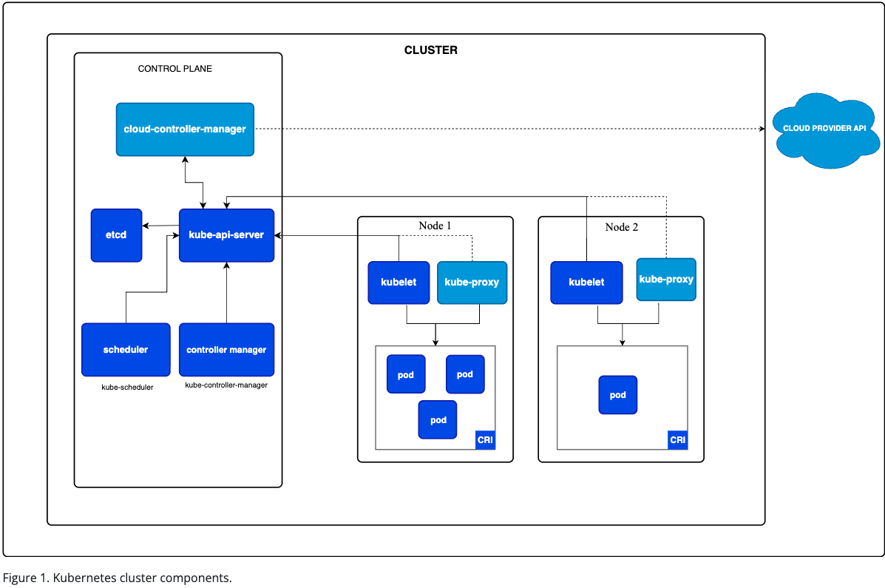
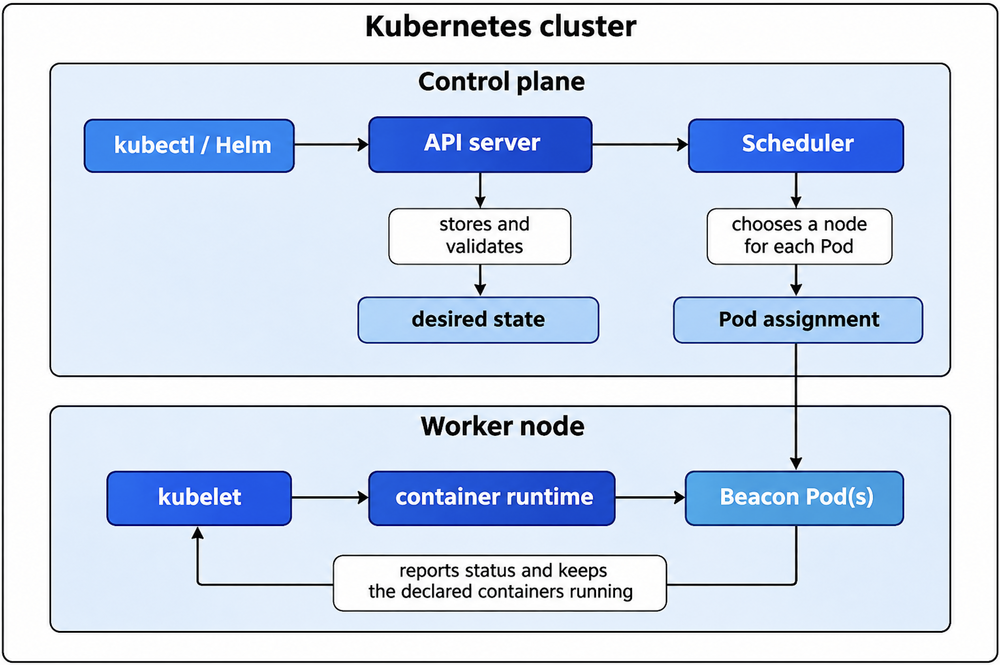

# Beacon

En liten webbapp som byggs vidare på under kursen Skalbara molnapplikationer.

Full dokumentation: [`docs/TUTORIAL.md`](./docs/TUTORIAL.md)

## Architecture

Beacon runs as three Pods managed by a Kubernetes Deployment. A Service gives those replaceable Pods one stable address, while an Ingress describes how HTTP traffic should reach that Service.





The **API server** is the front door of the control plane. `kubectl`, Helm, controllers, and kubelets communicate with Kubernetes through it. It authenticates and validates requests and records the desired state of resources.

The **scheduler** watches for Pods that do not yet have a node. It compares their resource requests and other placement rules with the available nodes, then assigns each Pod to a suitable node. It chooses placement but does not start containers itself.

The **kubelet** is the agent running on every worker node. It watches the API server for Pods assigned to its node, asks the container runtime to pull images and start containers, runs health probes, and reports Pod status back to the control plane.

When `kubectl apply` sends a Deployment manifest, the API server validates and stores it. The Deployment controller creates the required Pod definitions through a ReplicaSet. The scheduler assigns each new Pod to a node. That node's kubelet pulls the declared image, supplies the ConfigMap and Secret values, and starts the container. Readiness and liveness probes call `/health`; a ready Pod becomes an endpoint behind the Service. Kubernetes continues comparing actual state with desired state and replaces a failed Pod when necessary. Helm follows the same path: it renders this repository's chart into Kubernetes manifests and submits them to the API server.

## How traffic gets in

This solution uses **Traefik** as its ingress controller. The Ingress resource selects the `traefik` ingress class and routes requests for `/` to the `beacon` Service on port 80. Traefik reads that rule and handles incoming HTTP traffic.

The Service is still required because it provides a stable internal address and distributes requests across the ready Beacon Pods on port 8080. A `ClusterIP` Service is reachable only inside the cluster; it does not describe external HTTP hosts or paths. The Ingress adds those Layer 7 routing rules, while Traefik provides the actual entry point and forwards matching requests to the Service.

```text
Client -> Traefik ingress controller -> Ingress rule -> beacon Service -> ready Beacon Pod
```

## How to run it

Run these commands from the repository root against an empty cluster. The cluster must have the Traefik ingress controller installed; k3d includes it by default. On AKS, install Traefik as described in [`docs/Module04.md`](./docs/Module04.md).

### 1. Create the image pull Secret

Use a GitHub token that has only `read:packages`. The token is read silently and removed from the shell variable after the Secret is created:

```bash
printf 'GitHub token: '
read -rs GHCR_TOKEN
echo

kubectl create secret docker-registry ghcr-secret \
  --docker-server=ghcr.io \
  --docker-username=steose \
  --docker-password="$GHCR_TOKEN"

unset GHCR_TOKEN
```

### 2. Create Beacon's application Secret

Enter the application key without placing it in the repository or shell history:

```bash
printf 'Beacon API key: '
read -rs BEACON_API_KEY
echo

kubectl create secret generic beacon-secret \
  --from-literal=BEACON_API_KEY="$BEACON_API_KEY"

unset BEACON_API_KEY
```

### 3. Install the Helm chart

```bash
helm upgrade --install beacon ./charts/beacon \
  --wait \
  --timeout 5m
```

### 4. Verify the application

Check the release and Pods:

```bash
helm status beacon
kubectl get pods -l app=beacon
kubectl get service,ingress
```

All three Pods should report `1/1` under `READY`.

For the local k3d cluster created by the course, call Beacon through Traefik:

```bash
curl http://localhost:8080/
curl http://localhost:8080/health
curl http://localhost:8080/info
```

On AKS, use the public address assigned to Traefik:

```bash
IP=$(kubectl get service traefik \
  --namespace traefik \
  --output jsonpath='{.status.loadBalancer.ingress[0].ip}')

curl "http://$IP/"
```

## AKS and Pipeline

A green run of the pipeline: [Release version 6](https://github.com/Steose/smApp-beacon/actions/runs/42009549180)
